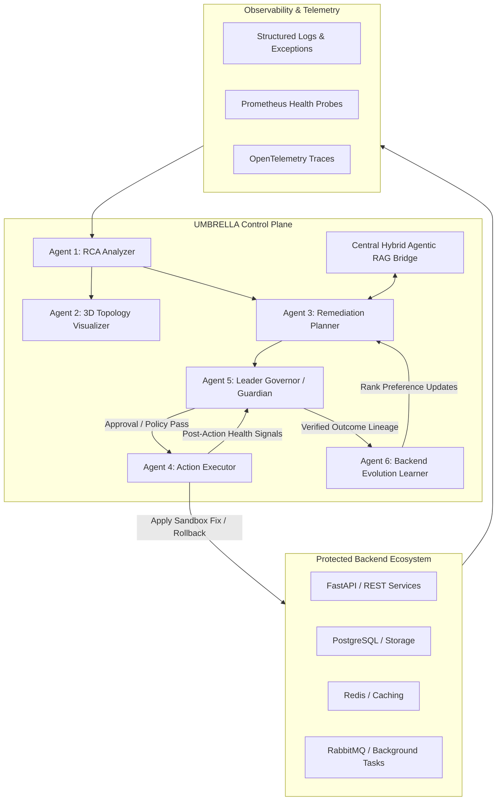

# Project UMBRELLA: Enhanced Architecture, Workflows & Visual System Guide

> **Risk-Aware Multi-Agent Autonomous Reliability Framework**  
> *Author*: Harman Saini | *Version*: 1.0 (October 2026)

---

## 1. High-Level Control Plane Architecture

The protected backend ecosystem (FastAPI, databases, Redis, message queues) remains untouched at runtime; UMBRELLA sits above it as an intelligent reliability control plane.



---

## 2. End-to-End Incident Lifecycle

The workflow operates on a strict **closed-loop reliability cycle**:

1. **Detect**: Continuous telemetry ingestion flags an HTTP 500 spike, timeout, or deadlock.
2. **Diagnose**: Agent 1 isolates the root cause (e.g., PostgreSQL connection pool exhaustion).
3. **Visualize**: Agent 2 highlights the affected microservice node and downstream blast radius on the 3D topology map.
4. **Plan**: Agent 3 queries the Hybrid Agentic RAG for matching runbooks and past verified fixes, formulating a step-by-step remediation task.
5. **RAG Ground**: RAG cross-references the proposed fix with actual code AST and API schemas to eliminate hallucination.
6. **Risk Gate**: Agent 5 evaluates risk score, reversibility, and blast radius.
7. **Approve**: If risk > Tier 1, human-in-the-loop (HITL) approval is requested via the side panel.
8. **Execute**: Agent 4 applies the patch in an isolated sandbox or git worktree.
9. **Verify**: Post-action health checks run for a defined observation window. **If verification fails, immediate automated rollback occurs.**
10. **Learn**: The verified outcome (success, recovery duration, side effects) is committed to System Evolution Memory for Agent 6.

---

## 3. Inter-Agent Message Sequence

```
Telemetry        Agent 1 (RCA)      Agent 3 (Plan)         RAG Bridge       Agent 5 (Guardian)   Agent 4 (Exec)
   │                   │                  │                     │                    │                 │
   │─── Incident ─────►│                  │                     │                    │                 │
   │                   │─── Diagnosis ───►│                     │                    │                 │
   │                   │                  │─── Knowledge Query ─►│                    │                 │
   │                   │                  │◄── Evidence Chunks ─│                    │                 │
   │                   │                  │                                          │                 │
   │                   │                  │────────── Proposed Plan ────────────────►│                 │
   │                   │                  │                                          │                 │
   │                   │                  │                                          │── Action Auth ─►│
   │                   │                  │                                          │                 │── Apply Sandbox Diff
   │                   │                  │                                          │◄─ Exec Result ──│
   │                   │                  │                                          │                 │
   │◄── Health Probes ───────────────────────────────────────────────────────────────│                 │
   │                   │                  │                                          │                 │
   │                   │◄─── Verified Recovery / Update Outcome Memory ──────────────│                 │
```

---

## 4. 3D Digital-Twin System Topology Concept

- **Nodes**: APIs, databases, caches, queues, and external integrations.
- **Edges**: Dependency calls, latency weightings, and network data flow.
- **Dynamic States**:
  - `HEALTHY` (Green): Nominal throughput and response latency.
  - `DEGRADED` (Yellow): Latency threshold breached or retry rate climbing.
  - `FAILED` (Red pulsing): Active 5xx errors or process crash.
  - `RECOVERING` (Cyan): Patch applied, awaiting health probe confirmation.
- **Visual Tech Stack**: React Three Fiber / Three.js for 3D spatial navigation, combined with React Flow for 2D schema graphs.

---

## 5. Dashboard Information Architecture

| Dashboard Screen | Operator Experience & Visibility |
|---|---|
| **Command Center** | Fleet-wide availability, active incidents, MTTR metrics, active agent states. |
| **Incident Workspace** | Timeline, root-cause summary, evidence snippets, proposed code diffs. |
| **3D Topology** | Interactive digital twin, dependency paths, live blast-radius boundaries. |
| **Remediation Center** | Step-by-step task cheat sheet, RAG source citations, risk scores, approval buttons. |
| **Agent Trace** | Structured inter-agent communication messages, tool executions, confidence scores. |
| **Audit & History** | Tamper-evident incident logs, human approver signatures, post-fix regression evaluations. |
